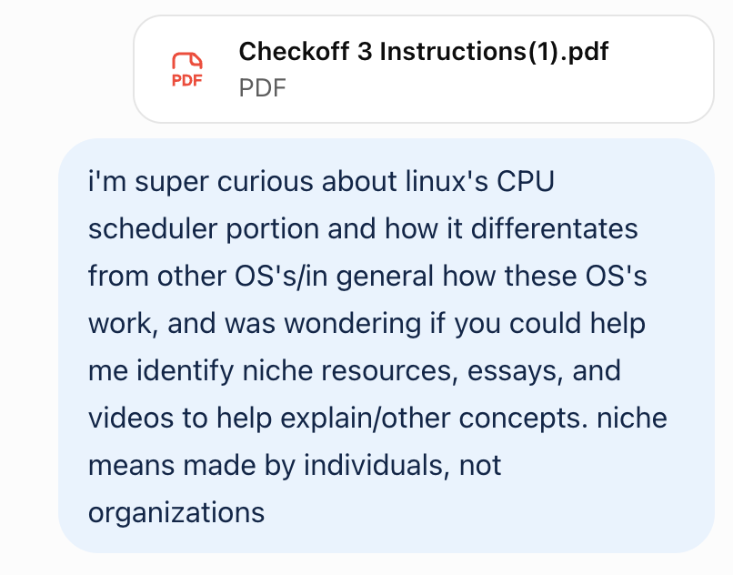
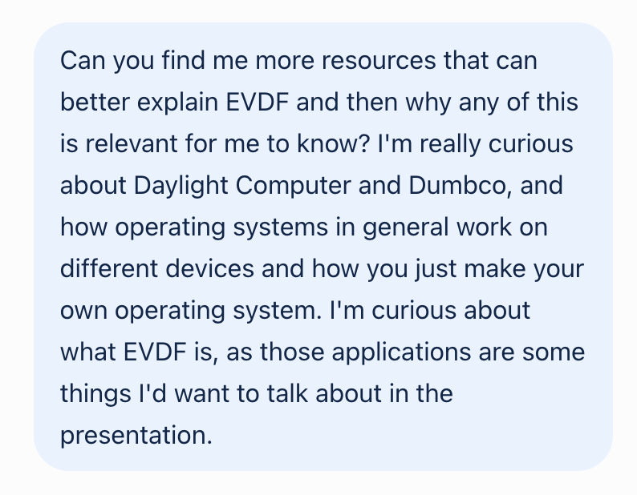

# Linux CPU Scheduler

5-7 minute video recording: https://drive.google.com/file/d/1Wj58gr2nQuswhpANUlNwwyPJZYC5a0Fv/view?usp=sharing

COMP 211 checkoff 3

I used AI to find resources that could help me understand operating systems and EEVDF. The prompts below show how I explored Linux CPU scheduling, learned the general terminology, and looked for material to help explain EEVDF and why it matters.

This prompt helped me find the University of Wisconsin–Madison's public operating systems textbook. I used it to learn general terminology and read Chapter 7, “CPU Scheduling,” about earlier scheduling methods such as shortest-job-first and round robin.

This was helpful to find applications to Daylight Computer and Dumb Co., two companies I've been following for a while, and two that have different operating systems. 

Found a lot of use case in Gemini for short questions.

Overall enjoyed this assignment and taught me a lot about how operating systems work.
